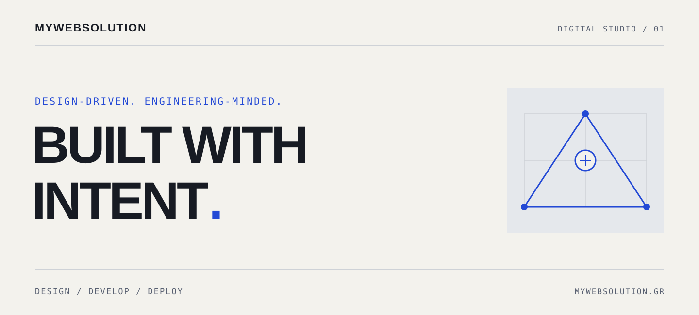

<picture>
  <source media="(prefers-color-scheme: dark)" srcset="https://raw.githubusercontent.com/MyWebSolution-MWS/.github/main/profile/assets/hero-dark.svg">
  <source media="(prefers-color-scheme: light)" srcset="https://raw.githubusercontent.com/MyWebSolution-MWS/.github/main/profile/assets/hero-light.svg">
  
</picture>

**Σχεδιάζουμε και αναπτύσσουμε ιστοσελίδες και web εφαρμογές με προσοχή στην εμπειρία και στην τεχνολογία που τη στηρίζει.**

We design and develop websites and web applications, from the interface to the foundations behind it.

[Ελληνικά](#ελληνικά) &nbsp; / &nbsp; [English](#english) &nbsp; · &nbsp; [mywebsolution.gr](https://mywebsolution.gr/)

---

## Ελληνικά

### Σχεδιασμός με σκέψη. Υλοποίηση με συνέπεια.

Στη MyWebSolution αντιμετωπίζουμε τον σχεδιασμό και την ανάπτυξη ως μέρη της ίδιας δουλειάς. Μια σαφής εμπειρία χρειάζεται προσεγμένο περιβάλλον χρήσης, λειτουργικότητα στο frontend και στο backend, και αρχιτεκτονική που μπορεί να συντηρηθεί. Η απόδοση και η προσβασιμότητα έχουν θέση στις αποφάσεις από την αρχή.

### Τι δημιουργούμε

**Ιστοσελίδες** / Responsive παρουσίες με ξεκάθαρη δομή, προσεγμένο σχεδιασμό και αξιόπιστη υλοποίηση.

**Web εφαρμογές** / Διαδραστικό λογισμικό για το web, σχεδιασμένο γύρω από πραγματικές ανάγκες και ροές εργασίας.

**Προσαρμοσμένα περιβάλλοντα χρήσης** / Συστήματα διεπαφής που συνδυάζουν συνεπή οπτική γλώσσα με κατανοητή λειτουργικότητα.

**Τεχνικές βάσεις** / Επιλογές στον κώδικα και στην αρχιτεκτονική με γνώμονα την απόδοση, την προσβασιμότητα και τη δυνατότητα συντήρησης.

### Πώς σκεφτόμαστε

> Ο καλός σχεδιασμός δίνει μορφή στην ιδέα. Η προσεγμένη μηχανική την κάνει λειτουργική.

Ξεκινάμε από το πρόβλημα και σχεδιάζουμε για τους ανθρώπους που θα χρησιμοποιήσουν το αποτέλεσμα. Προτιμούμε κατανοητό κώδικα, επαναχρησιμοποιήσιμα στοιχεία και τεχνολογικές επιλογές που υπηρετούν τις απαιτήσεις. Βλέπουμε την ασφάλεια, τις ελεγχόμενες διαδικασίες δημοσίευσης και τη συνεχή βελτίωση ως μέρος της υπεύθυνης ανάπτυξης.

Η προσέγγισή μας συνδέει την κατανόηση και τον σχεδιασμό της εμπειρίας με την υλοποίηση, τον έλεγχο και τη βελτίωση - με προσοχή και σε όσα ακολουθούν μετά τη δημοσίευση.

### Ας συζητήσουμε

Σχεδιάζετε μια ιστοσελίδα ή μια web εφαρμογή; Ας δούμε μαζί την εμπειρία, τις λειτουργικές ανάγκες και την κατάλληλη τεχνική προσέγγιση.

[Επισκεφθείτε το mywebsolution.gr →](https://mywebsolution.gr/)

---

## English

### Thoughtful design. Deliberate engineering.

At MyWebSolution, design and development belong to the same conversation. A clear experience depends on considered interfaces, frontend and backend functionality, and architecture that can be maintained. Performance and accessibility inform the decisions from the start.

### What we build

**Websites** / Responsive sites with clear structure, considered design and reliable implementation.

**Web applications** / Interactive software for the web, shaped around real requirements and workflows.

**Custom interfaces** / Interface systems that bring a consistent visual language and understandable functionality together.

**Technical foundations** / Code and architecture choices made with performance, accessibility and maintainability in mind.

### How we think

> Good design gives an idea form. Careful engineering makes it work.

We start with the problem and design for the people using the result. We value readable code, reusable components and technology choices grounded in requirements. Security-conscious development, considered deployment practices and continuous improvement are part of the work.

Our approach connects understanding the problem and planning the experience with implementation, testing and refinement - including the decisions that matter after launch.

### Start a conversation

Building a website or web application? Let's discuss the experience, the functional requirements and the engineering behind it.

[Visit mywebsolution.gr →](https://mywebsolution.gr/)

---

**MYWEBSOLUTION**

DESIGN WITH INTENT. BUILD WITH PRECISION.
